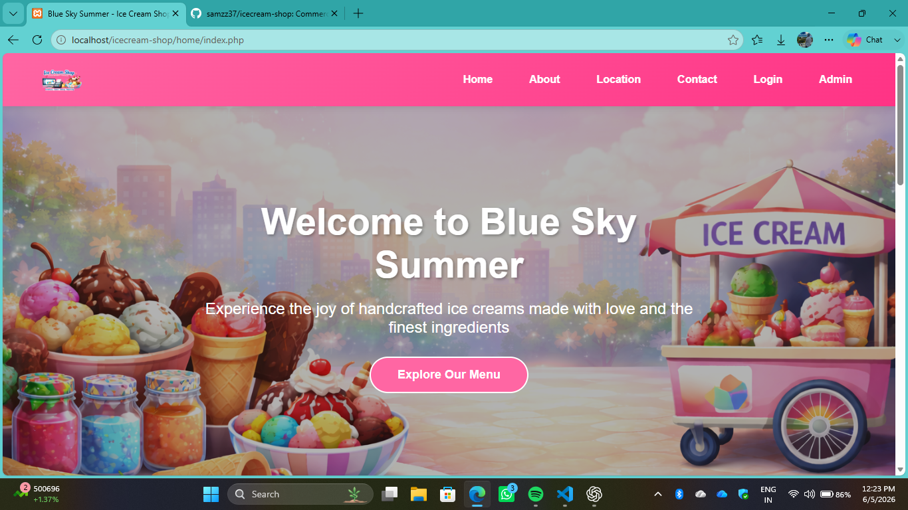
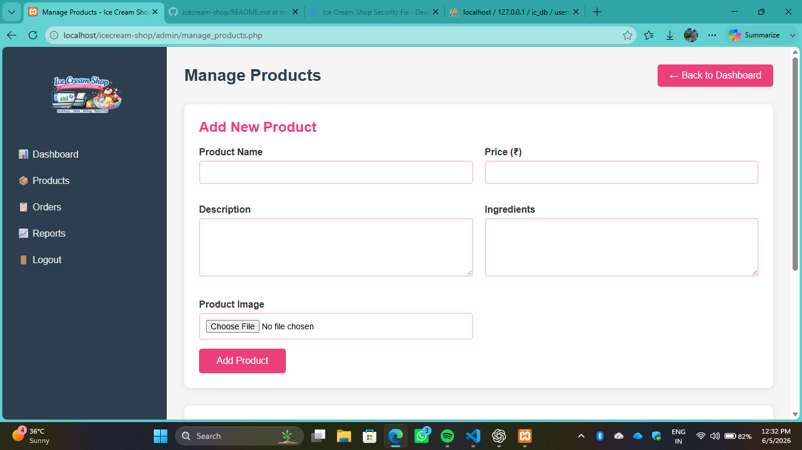
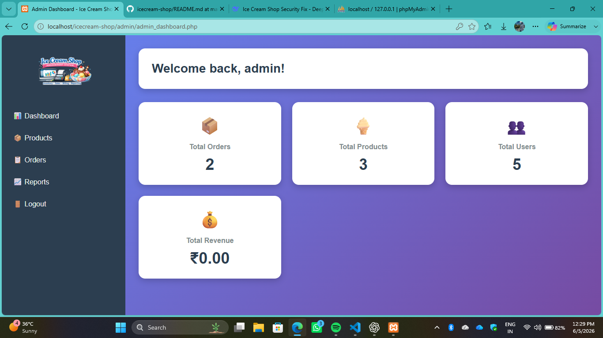

# 🍦 Ice Cream Shop Management System

A commercial web application developed for managing an ice cream business. The system provides product management, customer ordering, shopping cart functionality, and an administrative dashboard for efficient business operations.

## 📖 Overview

This project was developed as a real-world business solution for an ice cream shop. It helps streamline daily operations, manage products, track customer orders, and improve overall business efficiency through a centralized management system.

## ✨ Key Features

### Customer Features
- Product Catalog
- Product Search & Filtering
- Shopping Cart
- Online Ordering
- User Registration & Login
- Responsive Interface

### Admin Features
- Admin Dashboard
- Product Management
- Category Management
- Order Management
- Customer Management
- Inventory Monitoring
- Business Reporting

## 🛠 Technologies Used

- PHP
- MySQL
- HTML5
- CSS3
- JavaScript
- Bootstrap
- XAMPP

## 📸 Screenshots

### Home Page

### Product Catalog

### Admin Dashboard

## 🚀 Deployment

This project is currently maintained as a commercial solution and source code is available here for portfolio demonstration purposes.

## 👨‍💻 Developer

**Sam Jebaraj S**

- MCA Student
- Web Developer
- Python Developer
- Aspiring Game Developer

GitHub: https://github.com/samzz37

LinkedIn: https://www.linkedin.com/in/sam-jebaraj-s-6273781b1

## 📌 Project Status

✅ Production Ready  
✅ Commercial Project  
✅ Admin Panel Implemented  
✅ Shopping Cart Implemented  
✅ Online Ordering Implemented  
✅ Database Integrated
